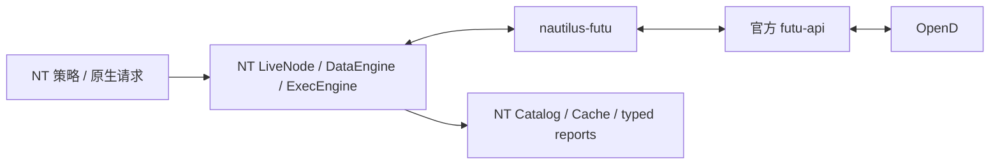

# 设计与协议语义

## 依赖边界

唯一生产 context 构造入口在 `transport.OpenDContextFactory`。`factories` 只实例化配置、Provider 与客户端；SDK 连接由 `_connect` 建立，`_disconnect` 关闭。没有研究服务、其他供应商、HTTP 下载器或任务调度依赖。`tests/test_boundary.py` 对源代码导入白名单和示例 SDK 直连做静态检查。

独立包的结构参考用户长桥连接器；Factory / Provider / 启动对账职责参考 [NT 官方 IBKR](https://github.com/nautechsystems/nautilus_trader/tree/develop/crates/adapters/interactive_brokers)。接口签名以本机安装的 rc8 为准；批量订阅字段由适配器逐项映射到供应商租约；不从参考连接器导入任何运行时代码。

## 生命周期与并发

每个 quote/trade context 使用单个 ThreadPoolExecutor 工作通道；异步锁防止在线程池内部积压失控的排队请求。调用先经过跨客户端、跨事件循环的线程安全限频器，再进入该通道。默认历史第一页预留 55/30 秒（供应商上限 60），后续分页不占第一页额度。下单/改单使用更保守的 15/30 秒及最小间隔；其他接口使用 20/30 秒。券商账户级额度可能还被其他进程消耗，供应商失败必须向上报告。

SDK 回调在工作线程中只拆包和入队，队列在调度事件循环之前就有容量上限；所有 NT 对象转换与输出均在所属 NT 事件循环。队列溢出记录 gap 并触发单一恢复协调任务；恢复废弃旧代次，重建 context，重新订阅与对账。SDK 自带重连造成的 quote 或 trade connection ID 改变也视为代次变化。启动期间溢出直接使启动失败，防止以不完整的账户状态就绪。

超时/取消不等于供应商未执行。工作通道标记为不可继续使用，迟到结果只收尾，不再次提交。关闭操作在线程通道中排在已开始的原生调用之后。原生调用受 SDK 连接超时和本包 asyncio 超时双重限制；Python 无法强杀任意卡住的本地扩展线程，若 SDK 本身永久卡死，进程级重启由运行环境负责。

同一订阅由本客户端内部租约合并。取消引用后等待至少 61 秒才请求退订；恢复重新登记，遵守 [富途订阅](https://openapi.futunn.com/futu-api-doc/quote/subscribe.html) 的最短订阅时间与额度约束。不会调用全账户 unsubscribe_all。连接器无法保证重连期间逐笔全部补齐；最近 1000 笔补取会标记覆盖不完整。

## 合约与价格

港股规范代码补足五位，US 类别股保留符号中点号。所有 NT 标识使用逻辑 venue FUTU；真实交易所留在 `info.exchange_type`，不会用路由 venue 冒充证券上市交易所。静态资料必须来自 OpenD；元数据包含原始响应及收到时间。

富途静态基础资料不提供可靠币种字段；常规 US 使用 USD、常规 HK 使用 HKD 并标记依据。HK 8 开头柜台及 ETF 美元柜台需显式币种覆盖。每手数量、证券类别、stock_id 和真实交易所不足时不开放委托。

股票价格规则使用 [HKEX 股票最小价差调整](https://www.hkex.com.hk/Services/Trading/Securities/Overview/Trading-Mechanism/Reduction-of-Minimum-Spreads?sc_lang=en) 的 2026-08-03 第二阶段版本；ETF 使用 [HKEX ETP 投资者价差表](https://www.hkex.com.hk/products/securities/exchange-traded-products/investors?sc_lang=en)。两张表以可序列化的 `info.price_ladder` 分别保存，并对每个分界点回归验证。rc8 Catalog 的自定义 tick scheme 名称在新进程中无法自行解析，因此 Equity.tick_scheme 留空，避免要求 Catalog 读取端初始化供应商连接器。NT price_increment 仅为表示精度，执行端另外按版本分档校验。不能把当前 bid/ask 价差当作固定 tick。规则有生效日期，不代表所有历史日期的执行规则。

US 使用 [富途下单文档](https://openapi.futunn.com/futu-api-doc/trade/place-order.html) 的小于 $1 四位、其他两位精度；改单保守限制在 SDK 文档的三位精度以内，避免供应商静默舍入。所有价格与数量先转 Decimal 校验，不自动改价、拆手数或补齐元数据。

## 行情时间与持久化

历史请求按市场本地日期分页，按 `ts_event` 二次过滤；相同事件时间重叠且 OHLCV 一致可合并，冲突、游标不前进、错误合约或异常分页明确报错。取消会穿透等待，不交付迟到结果。每页使用真实响应收到时间作为其 `ts_init`。

rc8 会使用 response 边界裁剪历史数据，而历史 `ts_init` 必然晚于历史区间。适配器完成 `ts_event` 区间过滤后，以原 request_id 返回 BarsResponse，但 response.start/end 留空，原请求区间保留在 params。真实节点集成测试覆盖了“历史区间远早于实际接收时间”且仍收到标准回调；不伪造 `ts_init` 来绕开问题。

[实时 K 线接口](https://openapi.futunn.com/futu-api-doc/quote/get-kl.html) 默认前复权；[K 线推送](https://openapi.futunn.com/futu-api-doc/quote/update-kl.html) 未保留足够复权语义。因此推送仅触发 `get_cur_kline(autype=...)`，历史同样显式传 autype/session。US 时段由订阅 session 固定。进程中某一 BarType 首次声明的口径保留到进程结束，断开客户端也不能把同一类型改成另一复权口径。Catalog 的跨进程隔离由调用方负责。

首版仅发布已结束周期。US 收盘/半日市与 HK 午休/半日市来自 OpenD trading-day 数据；HK 收市竞价末根保守等待到 16:10（半日 12:10）之后。轮询查询最近三根、重连从最后事件时间历史补取并去重。已发布 Bar 的供应商修订只记诊断与可选证据，不静默改写 Catalog。

QuoteTick / TradeTick / L2 保留真实本地接收 `ts_init`。L2 时间优先取两侧 OpenD 服务器接收时间，分别保存在 FutuSourceEvent 中；没有该时间时标记 local_receipt_proxy。完整快照转为 CLEAR + ADD，sequence=0 明示供应商未提供 NT 意义上的盘口序号。只对有效双边顶层生成报价。

逐笔以 `(合约, 市场本地日期, sequence)` 作为来源身份，TradeId 用稳定摘要编码到 rc8 的 36 字符范围。成交条件冲突明确失败；来源不同的重复 CACHE / REALTIME 行按同一 sequence 合并。没有 sequence 时分配 `U-...` ID，每行保留，不能按价格/数量/时间摘要删除。主动方向按[富途逐笔定义](https://openapi.futunn.com/futu-api-doc/quote/update-ticker.html)映射，未知/中性保留 NO_AGGRESSOR。原始条件和推送来源通过 NT CustomData 伴随输出。

可选公共行情信封采用规范 JSON 与 SHA256，NaN/Infinity 和二进制分页键使用有类型标记的无损文本表示。数据异常不会被改成正常数值。原始证据只是供应商响应的记录，不认证复权质量、连续性或历史可用时间。

## 账户、身份与对账

一个执行客户端绑定明确 acc_id / 环境 / 账户类型，发现账户列表只用于校验，绝不按列表第一个账户下单。交易回调的 SDK DataFrame 会丢弃协议头账户字段；传输层从原始 `s2c.header.accID` 补回，然后按账户和环境过滤，隔离多个模拟账户。

remark 使用 trader_id + ClientOrderId 的稳定哈希（51 ASCII 字符），在调用 place_order 前先登记身份并输出 Submitted。富途[明确允许推送先于提交响应](https://openapi.futunn.com/futu-api-doc/trade/place-order.html)，因此回调可先绑定 venue_order_id，响应只确认同一身份，不重复接受。缺失或冲突身份进入查询确认；不自动重发不确定委托。重启身份来源为 NT 恢复的 Cache，已在 NT 内处理的成交 ID 不再重放。

REAL 订单变化与成交通过客户端输出函数提交；累计成交数量领先成交明细时暂缓终态，先查询真实成交。真实成交按 deal_id 去重；成交修正/取消不能作为普通新成交处理，明确拒绝并保留异常。外部订单报告保留外部身份，不自动认领或撤销；报告带上可取得的真实成交列表。撤单只能针对当前客户端明确拥有的订单。

统一账户中的非港美股股票/ETF、或不属于首版报告类型的外部订单，保留代码/外部订单身份和不支持原因在诊断中，不映射为另一个品种、不认领、不撤单。未确认委托恢复时还查询 SDK 默认 90 天历史订单；跨日缺失的真实成交可查询该合约历史成交。超过上游历史范围仍无法确认的订单继续保持未确认，需由 NT 层进一步核实。

**SIMULATE 的上游限制**：[当日成交查询](https://openapi.futunn.com/futu-api-doc/trade/get-order-fill-list.html)、[历史成交查询](https://openapi.futunn.com/futu-api-doc/trade/get-history-order-fill-list.html)、[成交推送](https://openapi.futunn.com/futu-api-doc/trade/update-order-fill.html)均只支持实盘。模拟使用真实 OrderStatusReport 中的累计数量/均价，由 NT 原生报告处理产生累计状态；不是供应商逐笔证据。离线真实节点测试同时覆盖这条路径和 REAL 假服务逐笔路径。

资金使用一个明确的估值币种；AccountBalance 表达 broker cash / frozen_cash / 差额，其他原始资产、购买力和可用资金留在 account info，不重复构造多个币种总资产。报告的初始/维持保证金可用时输出 MarginBalance；缺失时标记 UNAVAILABLE，不能把资金字段捏造为保证金。单一市场模拟账户返回 N/A 币种时可按已校验账户市场推断，并标明来源；统一账户币种不明确则拒绝。

每次成功查询完整持仓快照后，对已报告/NT Cache 中本账户原有、现在消失的合约输出 FLAT 报告。全部变化经 NT 输出接口，不直接修改 Cache 或 Engine。

手续费不在富途成交响应中；事件允许 commission=None，rc8 FillReport 必填 Money 时使用零占位并明确标记 UNREPORTED。不要用该占位认证实际交易成本；需要费用的应用应经 NT 账户信息/报告做后续处理，不能引入研究旁路。

## 验收边界

离线假服务可验证 NT 状态机与协议分支，不证明券商真实订单受理。真实 OpenD 本轮只运行只读请求；周末缓存推送不证明开市逐笔完整性、收盘末根推送、真实断线恢复或实盘成交费用。具体已测/未测项目见 VALIDATION.md。
